# Minecraft-26.4-Hollow-Horizons


<div align="center">

### Atualização 26.4 — a atualização do End que a Mojang se recusa a lançar

**Making what Mojang refuses to do.**

</div>

> Projeto de fã, feito pela comunidade. Não é um produto oficial do Minecraft e não tem aprovação nem vínculo com a Mojang ou a Microsoft. Toda a arte e todo o código daqui são originais.

---

## I. O começo: um fim que nunca recebeu uma continuação

O The End recebeu a última grande atualização em 2016. Vieram as Cidades do End, a Elytra, os shulkers e as flores de coro. Depois disso as ilhas externas continuaram iguais: pedra amarela, árvores de coro, endermen e a mesma paisagem por milhares de blocos.

Enquanto isso, a comunidade pediu o mesmo ano após ano: biomas de verdade nas ilhas externas, um jeito de não perder tudo ao cair no Vazio, equipamentos de mobilidade antes da Elytra e motivos para explorar além da primeira Cidade do End.

**Hollow Horizons é a resposta a esse pedido.** Ele não recria o jogo; *adiciona* ao Minecraft oficial (Java Edition) a expansão do End que a comunidade quer, no formato de uma atualização completa: quatro biomas, dezessete blocos, sete equipamentos, uma estrutura nova e as texturas de tudo isso no estilo do jogo.

E ele roda. Este repositório compila, gera um `.jar` jogável e é testado dentro de um servidor Minecraft de verdade a cada mudança.

---

## II. O meio: o que chega com Hollow Horizons

<div align="center">
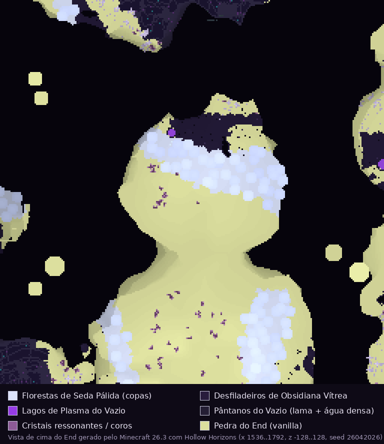
<br><sub>Vista de cima de ilhas externas geradas pelo próprio Minecraft 26.3 com a atualização (renderizada a partir dos arquivos de região do mundo).</sub>
</div>

### Gameplay screenshots

> Every image below comes from the real **Minecraft Java Edition 26.3** client running Hollow Horizons, with the game in English. They were captured automatically by the in-game client test (`./gradlew runClientGameTest`), which plays each scene with real keyboard and mouse input. Nothing is edited or mocked up.

#### Installed and running

<table>
<tr>
<td width="50%">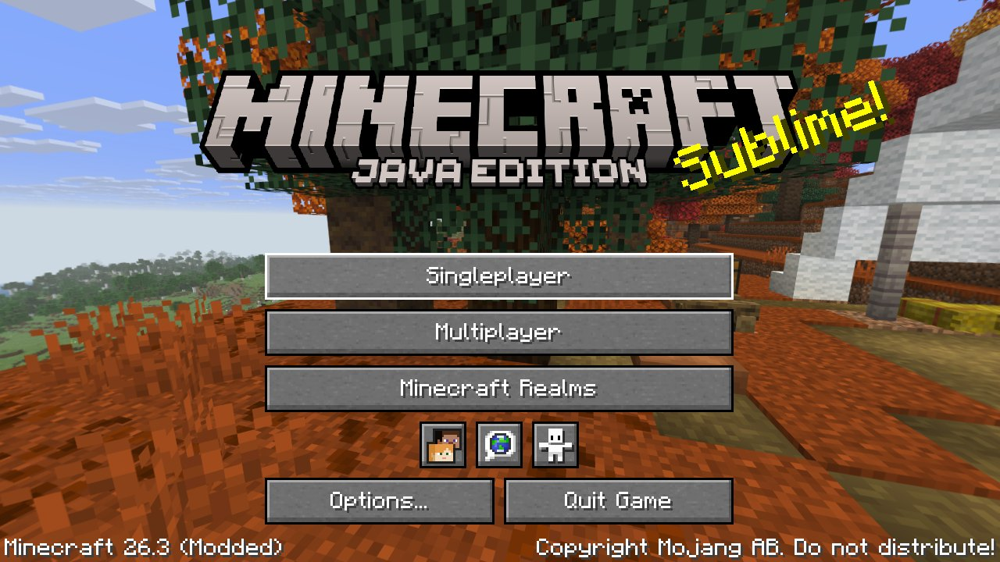<br><b>Title screen</b> — Minecraft Java 26.3 <i>(Modded)</i> with Fabric and Hollow Horizons loaded.</td>
<td width="50%">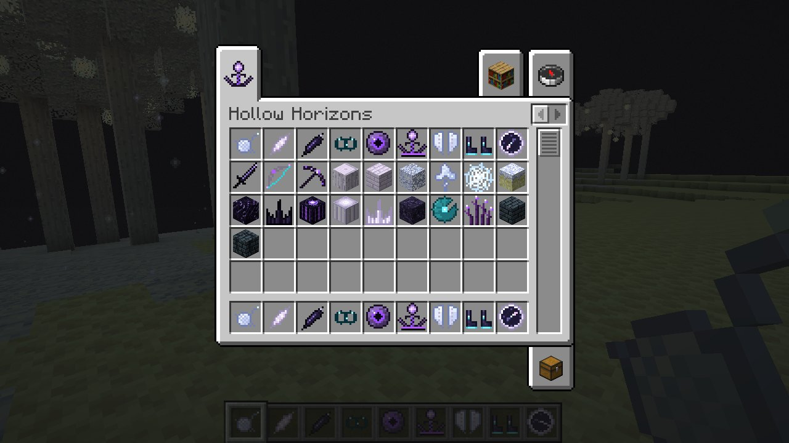<br><b>Creative tab</b> — every new item and block in the <i>Hollow Horizons</i> tab.</td>
</tr>
<tr>
<td width="50%">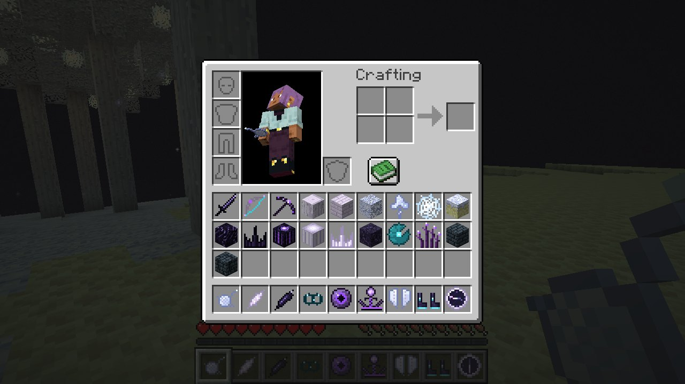<br><b>Survival inventory</b> — all items and blocks given with <code>/give</code>, rendered by the game.</td>
<td width="50%">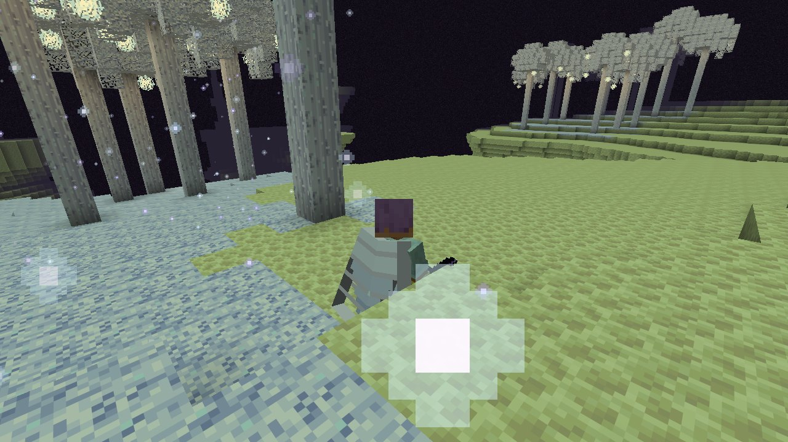<br><b>Equipped</b> — Silk Glider on the back, Null-Step Boots, Vitreous Cleaver in hand, Void Anchor in the off hand.</td>
</tr>
</table>

#### The new items in use

<table>
<tr>
<td width="50%">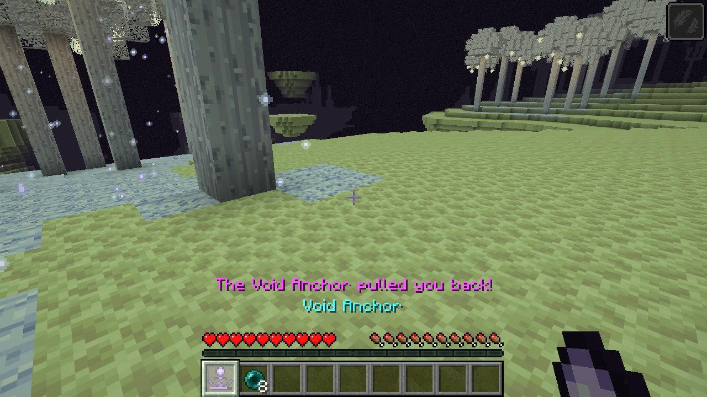<br><b>Void Anchor</b> — the player was dropped below the world and pulled back to the last solid block: <i>“The Void Anchor pulled you back!”</i></td>
<td width="50%">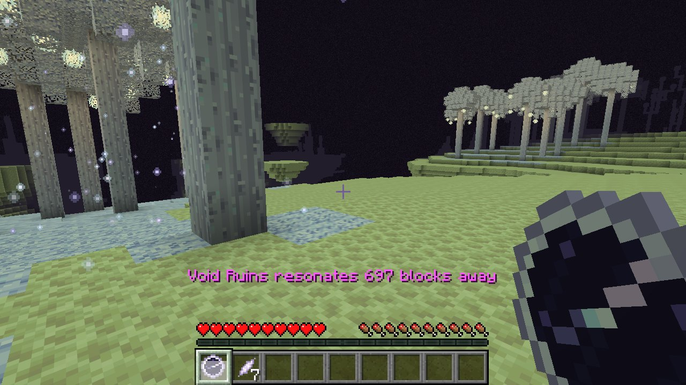<br><b>Resonance Compass</b> — one Resonant Shard later: <i>“Void Ruins resonates 697 blocks away”</i>, and the needle points there.</td>
</tr>
<tr>
<td width="50%">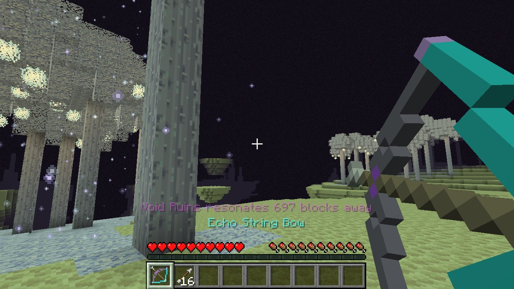<br><b>Echo String Bow</b> — held in hand; the test then fires it and checks on the server that the echo arrow flies with no gravity.</td>
<td width="50%">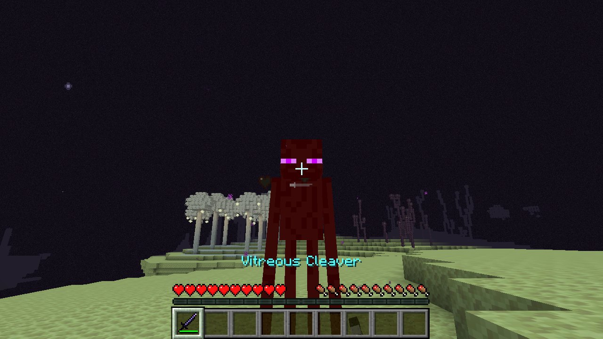<br><b>Vitreous Cleaver</b> — hitting an Enderman (it flashes red); +4 damage against End creatures.</td>
</tr>
<tr>
<td width="50%">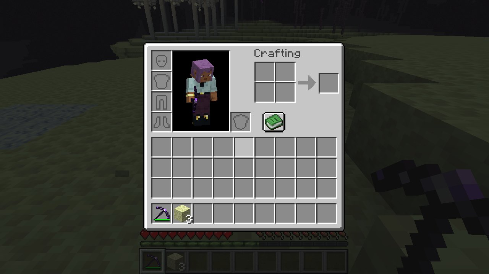<br><b>Hollow-Core Pickaxe</b> — End Stone mined in one hit and sent straight to the inventory, nothing dropped into the Void.</td>
<td width="50%">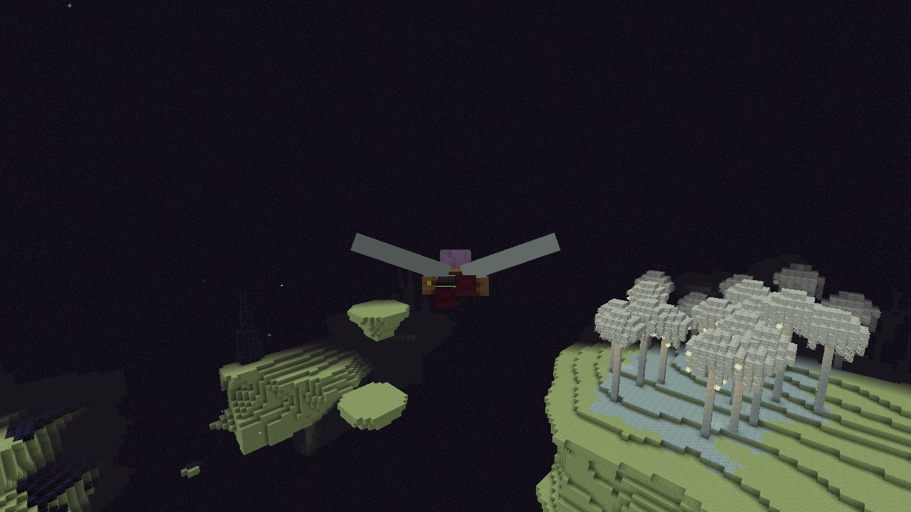<br><b>Silk Glider</b> — gliding between islands above a Pale Silk Woods.</td>
</tr>
<tr>
<td width="50%">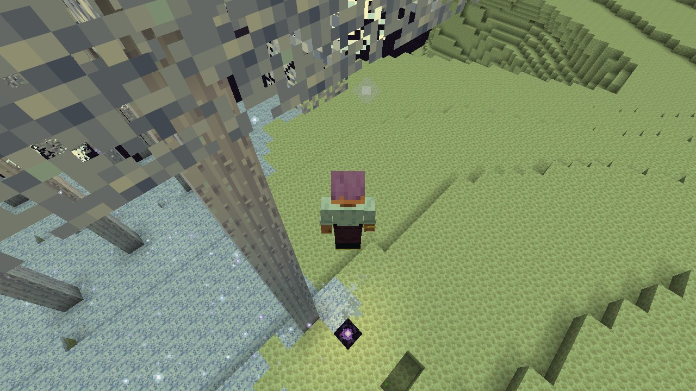<br><b>Updraft Vent</b> — standing on a vent lifts the player into the air (the test checks the height).</td>
<td width="50%"></td>
</tr>
</table>

#### The four new biomes and the Void Ruins

<table>
<tr>
<td width="50%">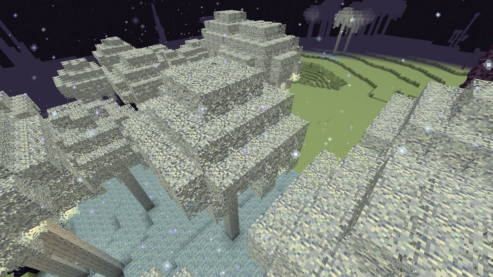<br><b>Pale Silk Woods</b> — tall white trees with glowing canopies and floating silk spores.</td>
<td width="50%">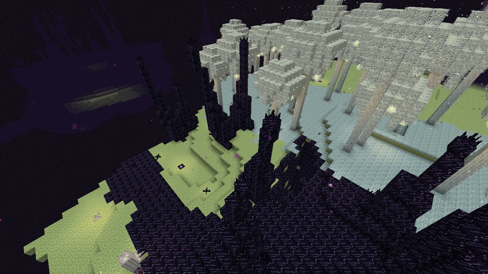<br><b>Vitreous Chasms</b> — black glass cliffs and spires cracking the islands apart.</td>
</tr>
<tr>
<td width="50%">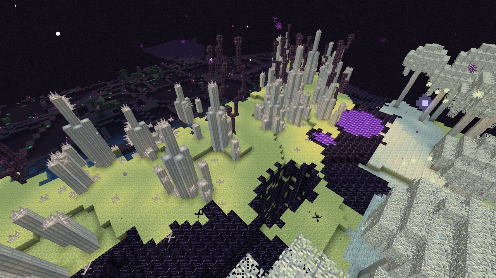<br><b>Resonant Spirefields</b> — fields of singing quartz towers.</td>
<td width="50%">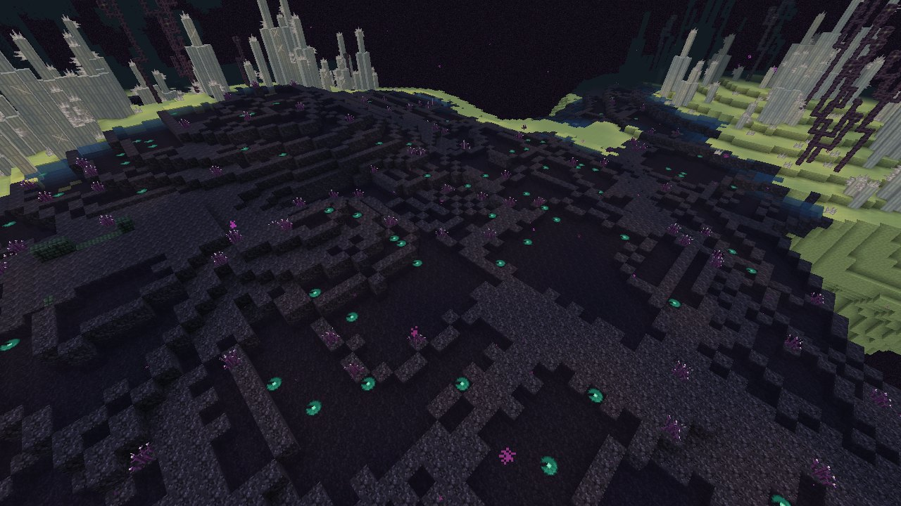<br><b>Void Fen</b> — dark mud, dense water and glowing lilies.</td>
</tr>
<tr>
<td width="50%">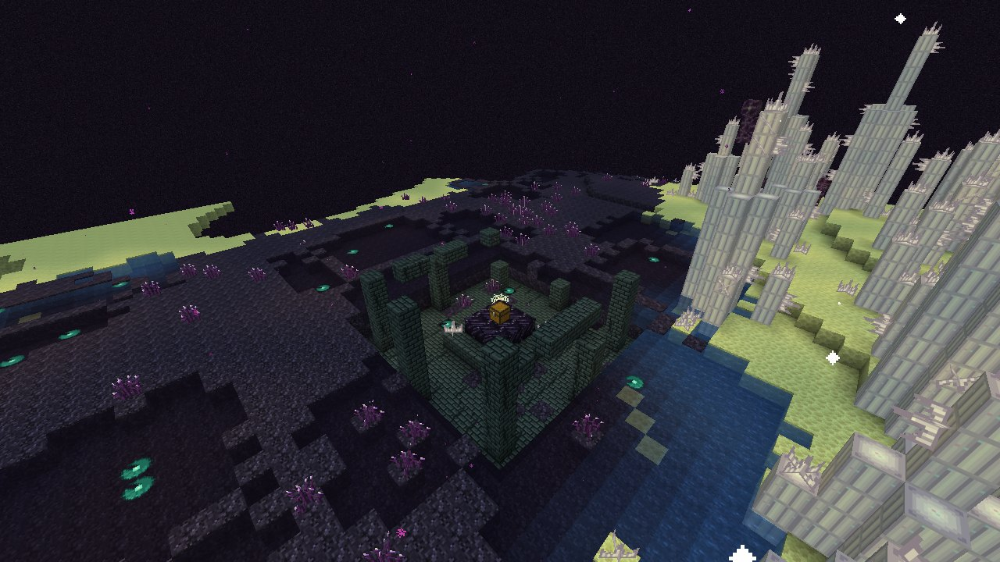<br><b>Void Ruins</b> — the sunken temple with its chest on the altar, found by the Resonance Compass.</td>
<td width="50%"></td>
</tr>
</table>

### Quatro biomas novos nas ilhas externas

Os biomas aparecem a partir de ~1.000 blocos do centro, no lugar de parte das "terras altas" do End. A ilha central e a luta contra o dragão continuam intactas. Cada bioma ocupa uma fatia equilibrada das terras altas e médias: cerca de 16% a 18% para cada um, e cerca de 35% continuam sendo o End vanilla.

| Bioma | O que você encontra |
|---|---|
| **Florestas de Seda Pálida**<br>`hollowhorizons:pale_silk_woods` | Árvores altas (9 a 16 blocos) de tronco branco e copa translúcida que **brilha no escuro** (luz 7). Das copas pendem **Teias de Luz**; no ar flutuam **esporos de seda** luminosos. O chão é **Musgo de Seda Pálida**. |
| **Desfiladeiros de Obsidiana Vítrea**<br>`hollowhorizons:vitreous_chasms` | Ilhas **rachadas de cima a baixo** por fendas com paredes de vidro negro, **espinhos afiados** de Obsidiana Vítrea de até 20 blocos, **gêiseres de ar ascendente** e **lagos de plasma roxo** que queimam e prendem quem cai neles. |
| **Campos de Cristal Ressonante**<br>`hollowhorizons:resonant_spirefields` | Planícies cobertas de **torres de quartzo ressonante**. Pisar nelas toca notas da **escala pentatônica**, afinadas pela posição de cada bloco, então caminhar produz acordes e não ruído. Quando o "vento" passa, as torres cantam sozinhas. |
| **Pântanos do Vazio**<br>`hollowhorizons:void_fen` | Ilhas baixas e **nebulosas** (neblina a 35% da distância normal), **água densa e escura**, **Lírios-do-Pântano** e **Juncos do Vazio** bioluminescentes e **ruínas meio submersas** de uma civilização anterior aos endermen. |

### Exploração e mobilidade

| Item | Como funciona |
|---|---|
| **Âncora do Vazio** | Se você cair no Vazio, a âncora é "arremessada" pela corrente de energia até o **último bloco sólido onde você pisou** e te puxa de volta (com 2 s de queda lenta). Guarda até **4 cargas**; **usar** consome 1 Pérola do Ender e recarrega 1 carga. **Agachar + usar** faz o arremesso manual. Cada puxão gasta 1 carga e deixa a âncora em **recarga de 30 s**. Funciona em qualquer lugar do inventário. |
| **Asas de Seda** | Uma Elytra inicial e frágil, feita das fibras da Seda Pálida (durabilidade 180). **Não aceita foguetes**, e a velocidade fica limitada (~23 blocos/s) com queda suave. Sobre um Gêiser de Ar ela **ganha altitude como numa térmica**. |
| **Botas de Gravidade Zero** | **Salto duplo**: aperte "pular" de novo no ar. Queda segura +3 blocos e, **nas ilhas do End, −80% de dano de queda** e +8 blocos de queda segura. |
| **Bússola de Ressonância** | Gasta 1 Fragmento Ressonante e passa a **apontar para a estrutura rara mais próxima** (raio de 100 chunks): **Cidade do End e seu Navio** ou **Ruínas do Vazio**. **Agachar + usar** troca o alvo. Só ressoa no End. |

### Combate e ferramentas

| Item | Como funciona |
|---|---|
| **Lâmina de Obsidiana Vítrea** | Espada pesada: 9,5 de dano e **1,0 ataque/s** (a espada comum faz 1,6). **+4 de dano contra criaturas do End** (enderman, endermite, shulker, dragão) e **ignora 40% da armadura** do alvo, somando-se ao encantamento Brecha. |
| **Arco de Eco** | Flechas voam **em linha reta, sem gravidade e sem imprecisão**, e **atravessam até 2 inimigos**. Como não caem, dissipam-se após 5 s no ar, para não vagarem pelo Vazio para sempre. |
| **Picareta de Núcleo Oco** | Nível netherite (1.800 de durabilidade). **Quebra blocos do End instantaneamente** (pedra do End, purpur, coro e os blocos novos) e **os itens minerados vão direto para o inventário**, sem nunca rolar para o Vazio. |

### Receitas

Na grade, cada linha é uma fileira da mesa de trabalho, e espaço vazio é casa vazia.

| Resultado | Grade | Legenda |
|---|---|---|
| Âncora do Vazio | ` P ` / `CRC` / `OCO` | P Pérola do Ender · C Corrente de Ferro · R Fragmento Ressonante · O Obsidiana Chorona |
| Asas de Seda | `TCT` / `T T` / `T T` | T Fio de Seda Pálida · C Fruta do Coro Estourada |
| Botas de Gravidade Zero | `S S` / `R R` | S Concha de Shulker · R Fragmento Ressonante |
| Bússola de Ressonância | ` R ` / `RBR` / ` R ` | R Fragmento Ressonante · B Bússola |
| Lâmina de Obsidiana Vítrea | ` VV` / ` VV` / `E  ` | V Obsidiana Vítrea · E Bastão do End |
| Arco de Eco | ` RX` / `F X` / ` RX` | R Bastão do End · F Fragmento Ressonante · X Corda de Eco |
| Picareta de Núcleo Oco | `VHV` / ` E ` / ` E ` | V Fragmento Vítreo · H Núcleo Oco · E Bastão do End |
| Núcleo Oco | `VRV` / `SES` / `VRV` | V Fragmento Vítreo · R Fragmento Ressonante · S Concha de Shulker · E Olho do Ender |
| Corda de Eco | sem forma | Fragmento de Eco + 2 Fios de Seda Pálida |
| Tábuas de Seda Pálida ×4 | sem forma | Tronco de Seda Pálida |
| Tijolos do Pântano ×4 | `MM` / `MM` | M Lama do Vazio |

**Onde achar os materiais:** o *Fio de Seda* cai das folhas de Seda Pálida e das Teias de Luz; o *Fragmento Ressonante* vem dos Aglomerados Ressonantes (4 por aglomerado, com Fortuna); o *Fragmento Vítreo*, dos aglomerados na ponta dos espinhos vítreos. O baú no altar das **Ruínas do Vazio** guarda pérolas, fragmentos e, com sorte, um Núcleo Oco, uma Âncora ou uma Bússola.

### Blocos novos

<div align="center">
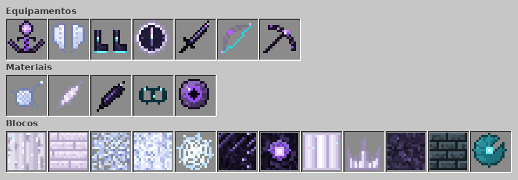
</div>

Tronco, tábuas, folhas, muda e musgo de Seda Pálida · Teia de Luz · Obsidiana Vítrea · Aglomerado Vítreo · Plasma do Vazio (animado) · Gêiser de Ar · Pilar e Aglomerado Ressonante · Lama do Vazio · Lírio-do-Pântano · Junco do Vazio · Tijolos do Pântano (e rachados).

**Sobre a arte:** nenhum PNG da Mojang foi copiado ou editado, porque redistribuir esses arquivos viola o EULA. Cada textura é desenhada pixel a pixel por [`tools/generate_textures.py`](tools/generate_textures.py), seguindo as regras de estilo do jogo: 16×16, paletas curtas em rampa de luz vinda de cima à esquerda, contorno de 1 px no tom mais escuro do próprio material e recorte binário em folhas e plantas.

### Como jogar (instalação em 3 passos)

1. Instale o **[Fabric Loader](https://fabricmc.net/use/installer/) 0.20.1 ou mais novo** para **Minecraft Java Edition 26.3**. O instalador cria o perfil "fabric-loader-26.3" no launcher oficial.
2. Baixe o **[Fabric API](https://modrinth.com/mod/fabric-api) 0.167.0+26.3** e o **[`dist/hollow-horizons-0.1.0.jar`](dist/hollow-horizons-0.1.0.jar)** deste repositório. Coloque os dois na pasta `mods` do Minecraft:
   - Windows: `%appdata%\.minecraft\mods`
   - macOS: `~/Library/Application Support/minecraft/mods`
   - Linux: `~/.minecraft/mods`
3. Abra o launcher, escolha o perfil do Fabric e crie um **mundo novo**. Os biomas só aparecem em chunks do End que ainda não foram gerados; em mundos antigos, só nas ilhas que você ainda não visitou.

Tudo também aparece na aba criativa **Hollow Horizons**. Para ver tudo rápido (em um mundo com comandos):

```
/execute in minecraft:the_end run locate biome hollowhorizons:pale_silk_woods
/execute in minecraft:the_end run locate structure hollowhorizons:void_ruins
/give @s hollowhorizons:void_anchor[hollowhorizons:anchor_charges=4]
```

**Para desenvolver** (requer JDK 25):

```bash
./gradlew runClient           # abre o jogo com a atualização
./gradlew build               # gera build/libs/hollow-horizons-0.1.0.jar
./gradlew runGameTest         # testes dentro de um servidor Minecraft real
./gradlew runClientGameTest   # abre o cliente real, usa cada item e salva as screenshots acima
python3 tools/smoke_test.py   # mundo real: localiza e gera os biomas e as ruínas no End
```

### Provado no jogo, não só no papel

Cada promessa desta página tem um teste que roda dentro do Minecraft (`src/gametest`):

- os 4 biomas aparecem nas ilhas externas **com o gerador real do End**, em proporção equilibrada, e a ilha central continua sendo `minecraft:the_end`;
- a picareta quebra pedra do End em 1 tick e manda o drop direto para o inventário;
- a âncora puxa de volta um jogador caindo no Vazio, entra em recarga e recarrega com pérolas;
- a lâmina dá +4 contra endermen e ignora 40% da armadura, e a espada comum não;
- a flecha de eco voa sem gravidade, perfura 2 alvos e se dissipa;
- as Asas de Seda recusam foguetes e limitam velocidade e queda, enquanto a Elytra continua aceitando;
- as botas permitem um único salto extra, zeram a queda e cortam 80% do dano no End;
- o gêiser empurra para cima, a bússola troca de alvo e as features e as Ruínas montam suas formas.

Além disso, o **teste de cliente** abre o jogo de verdade (janela, renderização, teclado e mouse), cria um mundo e usa cada item como um jogador: a âncora puxa do Vazio, a bússola acha as Ruínas, a picareta minera direto para o inventário, as asas planam e o gêiser ergue o jogador. As screenshots da seção *Gameplay screenshots* saem dele.

O [`tools/smoke_test.py`](tools/smoke_test.py) sobe um servidor com mundo normal (seed `26042026`), localiza no End os quatro biomas, as Ruínas do Vazio e uma Cidade do End via RCON, gera esses chunks e confere os blocos de cada lugar no terreno (musgo de seda, obsidiana vítrea, pilares ressonantes, lama, tijolos das ruínas). O GitHub Actions roda tudo isso a cada push.

### Como contribuir: um lugar para trazer o que a comunidade quer

```
src/main/java/dev/hollowhorizons/
  registry/    blocos, itens, componentes, tags, worldgen (pesos dos biomas)
  block/ item/ comportamento dos blocos e equipamentos
  gameplay/    âncora, botas, gêiseres e asas, sons ressonantes
  world/       features dos biomas e a estrutura Ruínas do Vazio
  mixin/       os poucos pontos onde o jogo precisa ser alterado
src/client/    partícula de esporo e salto duplo
src/gametest/  testes dentro do jogo
tools/         geradores de texturas e de JSON, teste de fumaça, renderizador do mapa
```

1. **Item ou bloco novo:** registre em `HHItems`/`HHBlocks`, acrescente o id em `tools/generate_data.py` (modelo, loot, receita, tradução) e desenhe a textura em `tools/generate_textures.py`.
2. **Bioma novo:** adicione o JSON do bioma e as features em `generate_data.py`, a chave em `HHWorldgen.ALL_BIOMES` e um peso em `HIGHLANDS_WEIGHTS`. O GameTest de biomas reprova qualquer bioma com menos de 8% das terras altas.
3. Rode `python3 tools/generate_data.py`, `python3 tools/generate_textures.py` e `./gradlew build runGameTest`, depois abra um pull request.

---

## III. O fim: o End não precisa mais esperar

Por dez anos, o fim do jogo foi literalmente o fim: derrotar o dragão, pegar a Elytra e nunca mais ter motivo para voltar. Hollow Horizons muda isso. As ilhas externas ganham florestas que brilham, desfiladeiros de vidro, campos que cantam e pântanos que escondem a história de quem viveu ali antes. O Vazio deixa de ser uma sentença de morte.

Isto não é um pedido para a Mojang fazer. É a atualização feita. Se a comunidade quer um End vivo, ele está aqui, compilando, testado e aberto para quem quiser trazer a próxima ideia.

**Making what Mojang refuses to do.**

<sub>Hollow Horizons 0.1.0 · Minecraft Java 26.3 (Fabric) · Código sob licença MIT. "Minecraft" é marca da Mojang Synergies AB; este projeto não é afiliado à Mojang nem à Microsoft.</sub>
